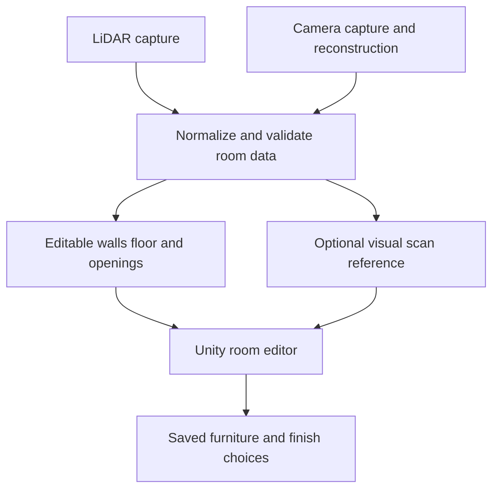

# OIS Designs project plan

## Recommended direction

Use Unity for the interactive room editor, subject to an early iPhone build and scan-import trial. This suits the developer's Unity/C# experience and a workflow dominated by selecting 3D objects, moving furniture, changing materials, and viewing a room from different angles. This is an engineering recommendation for this team, rather than a claim that Unity is universally best.

The [reference app](https://homeplannerapp.com/) demonstrates room capture, furniture placement, and finish exploration. Use those as workflow references; copying its full catalog, AI features, and whole-home scope would make a poor first milestone.

| Approach | When it fits | Main cost for this project |
| --- | --- | --- |
| Unity with a native capture bridge | A substantial 3D editor, C# experience, possible later Android editor | Native iOS integration, mobile rendering budgets, and iOS build infrastructure |
| SwiftUI and RealityKit with RoomPlan | Firmly Apple-only product with a team comfortable in Swift | Learning Swift and the Apple stack; macOS/Xcode development access |
| Flutter or React Native with embedded 3D | Forms, accounts, and business UI dominate the product | Adds a framework boundary around the main editor; not the initial recommendation for three people |
| Unreal | A team already experienced in Unreal with a demonstrated mobile pipeline | No identified advantage that justifies changing this team's workflow |

For an Apple-only product, prototype the Unity-to-native handoff before choosing permanently. If that handoff is unreliable or consumes the schedule, reassess native Apple development. Windows development remains possible in Unity; producing an iOS binary still needs an Apple build toolchain elsewhere.

Start with URP, a simple lighting setup, the Input System, and uGUI for the initial touch interface. These are proposed choices to reduce the initial learning load. Add AR Foundation and the matching ARKit provider if the Unity app owns AR capture or live AR placement. A room editor using an imported scan can run without a live AR session. [AR Foundation documentation](https://docs.unity3d.com/Packages/com.unity.xr.arfoundation@6.3/manual/index.html) explains its provider model and platform differences.

Unity 6000.6.5f1 is installed on the current Windows machine. Select one supported editor version after checking native-plugin and renderer compatibility; Unity 6.3 LTS is a reasonable candidate for a stable team baseline. Pin the exact editor and package versions in the generated Unity project. [Unity release support](https://unity.com/releases/unity-6/support) describes supported releases and support windows.

OIS should confirm the applicable Unity license before committing commercially. This is an architecture/design application, and Unity's industry terms include client-finance and service-provider provisions. Team size alone does not establish eligibility. [Unity Industry terms](https://unity.com/legal/industry-terms-of-service).

## Scan appearance and editable structure

LiDAR is a sensing technology. Gaussian splatting is a scene representation and rendering technique, usually reconstructed from multiple views. They can also be used together. Treat the two planned scanning routes as separate capture pipelines whose output must meet a shared app contract.

The original [3D Gaussian Splatting research](https://repo-sam.inria.fr/fungraph/3d-gaussian-splatting/) focuses on rendering novel views. For this product, infer that a visual splat alone is insufficient as an editing model: it does not inherently give the app independently selectable wall, floor, and furniture objects with reliable dimensions. Segmentation, geometry estimation, scale calibration, and cleanup are additional work.

[Apple RoomPlan](https://developer.apple.com/augmented-reality/roomplan/) is relevant because it uses camera and LiDAR input to produce parametric room components and dimensions. Its output is a structured approximation; do not assume it reproduces detailed furniture or photorealistic textures. RoomPlan uses a native Swift API. AR Foundation's ARKit support should not be treated as an automatic RoomPlan integration: assign ownership of a bridge or agree an exported-data handoff.

The editor should work from the structured room even when the visual scan is unavailable. Keep the original scan immutable and save design changes separately. See the [proposed contract](SCAN_CONTRACT.md).

Existing furniture is a major product decision. A scanned sofa is not automatically removable: hiding its splats can expose missing background. Use a reconstructed editable room shell for redesign, with the original scan as a reference. Automatic removal/inpainting is a separate capability to validate, not a promised side effect of importing a scan.

## One room MVP

The core user is an OIS designer preparing a client's room proposal. Confirm later whether clients also need their own editing or review accounts.

1. Create a project and capture or import one supported room.
2. Review room size and correct important measurements.
3. Navigate a 3D room and a simple top-down view using the same room data.
4. Select furniture from a small approved catalog; move, rotate, duplicate, and delete it at real-world scale.
5. Select individual walls or the floor and apply an approved finish.
6. Undo/redo design edits, save locally, and reopen the same design after restarting.
7. Export a presentation screenshot and an item/finish summary for client discussion.

Start editor development with a rectangular sample room. Before calling scan integration complete, define which actual room shapes and openings the MVP accepts. Explicitly reject unsupported geometry rather than silently changing a client's room.

The requested product includes both camera/splat and LiDAR routes. Propose LiDAR as the first integration because target Pro devices may support RoomPlan, then prove the camera route separately. OIS must agree if the first release includes only one route. If both are required for the MVP, schedule and accept both as independent deliverables.

Defer automatic empty-room reconstruction, AI interior redesign, collaborative editing, procurement integrations, a large catalog, and whole-house capture until the one-room workflow passes phone testing. Confirm the treatment of ceilings, doors, windows, and existing objects explicitly.

## Divide the app team by ownership

| Owner | Primary responsibility | First deliverable | Integration boundary |
| --- | --- | --- | --- |
| You: app workflow and editor experience | Screen flow, touch interactions, camera navigation, catalog UI, surface selection, finish controls, designer feedback | Sample room with one placeable item and one editable wall | Calls editing commands and consumes catalog/room data |
| Developer 2: room data and scan integration | Room model, importer, procedural room shell, openings, colliders, scale/coordinate conversion, native handoff coordination | Synthetic fixture and one real scan reconstructed at correct scale | Normalized room contract; bridges owned explicitly with scanning team |
| Developer 3: persistence, assets, and delivery | Furniture/material catalog pipeline, stable IDs, save/load, export, iOS signing/builds, on-phone performance | Signed iPhone build that saves and reopens a project | Versioned project files, asset identifiers, reproducible builds |

Assign owners provisionally until the other developers' experience is known. Each feature still needs review by another developer; avoid making one person the only person who can build or release the app.

The separate scanning team should own capture guidance, reconstruction, structural extraction, confidence reporting, and mobile-compatible output. Name one person in each team as integration contact. Agree explicitly who writes the Swift/native bridge, who runs processing infrastructure, and who supports failed scans. Native integration is not allowed to fall between teams.

Avoid assigning one person only menus, one only scanning screens, and one only a single editing screen: all three would still need to change the same shared model without clear ownership.

## Build order and acceptance gates

These are sequenced milestones, not a promised timeline. The deadline and team availability have not been supplied.

| Milestone | Work | Evidence required |
| --- | --- | --- |
| 0: establish delivery | Confirm target devices, account ownership, build infrastructure, editor version, scan bridge responsibilities, and contract | A minimal signed app launches on the developer's iPhone 13; scanning team identifies a LiDAR test phone |
| 1: prove editing | Load the synthetic room; place one true-size object; change a wall; save/reopen | A physical-phone demo preserves dimensions, transforms, and finish IDs |
| 2: prove real scan handoff | Import one structured LiDAR result, inspect doors/windows, compare measured distances | A designer confirms scale and important dimensions; bad/missing data is handled visibly |
| 3: finish one-room workflow | Small catalog, floor materials, top-down view, undo/redo, duplicate/delete, screenshot/summary | An OIS designer completes a proposal without developer help |
| 4: prove camera route | Import camera reconstruction plus its structured shell, calibrate scale, benchmark actual splat runtime | Both visual quality and editing work on supported real phones; processing time and recovery are measured |
| 5: release candidate | Data-loss checks, failure handling, thermal testing, release-build checks, client workflow review | Agreed one-room acceptance checklist passes for every advertised capture route and target model |

If both capture routes are release requirements, milestone 4 is mandatory. If splats are optional references, the structured editor can still progress while that renderer is evaluated.

The popular [aras-p UnityGaussianSplatting implementation](https://github.com/aras-p/UnityGaussianSplatting) explicitly reports uncertain mobile support and failing devices. A desktop demonstration is insufficient evidence for selecting it. Evaluate any renderer for runtime loading, iOS/Metal support, URP integration, sorting/transparency, memory, and sustained performance on your actual phones. Do not assume an editor-only importer supports downloaded client scans.

## App design decisions

Use a short flow: Projects -> Capture or import -> Review room -> Design -> Save and present. Keep capture, processing, review, and editing as explicit states. Make cancellation, permission denial, upload failure, and retry understandable.

Within the editor, show the room, a catalog/finishes panel, selection feedback, undo/redo, and save status. Define how one-finger object dragging differs from camera orbit, how two-finger pan/pinch works, and how UI taps are prevented from selecting geometry behind the panel. Test the conventions with OIS designers before expanding controls.

Keep furniture dimensions locked to catalog measurements by default; arbitrary pinch scaling can imply a real sofa comes in a size that does not exist. Use pinch for camera zoom. Provide numeric position/rotation or clearance controls where designers need precision. Clarify any deliberately resizable product variants.

Surface selection must identify separate walls and floors. Build geometry/UVs so a floor tile or wood plank repeats at a specified physical size. Preserve openings instead of painting over doors/windows. Allow helpful cutaway walls in the editor and inspect whether this makes material selection confusing.

Show measurement confidence and allow corrections. Agree tolerances against measured reference distances; no scan method establishes construction-grade accuracy by name alone. Finish colors depend on lighting, material response, phone display, and real samples, so OIS should define the intended fidelity of client previews.

## Data and asset considerations

- Use meters internally, stable project/room/surface/item IDs, and versioned serializable data. Support display conversion to feet/inches without changing stored units.
- Keep geometry data, visual scan assets, and designer edits separate. Save asset IDs and transforms, not references to live Unity GameObjects.
- Record furniture dimensions, pivot conventions, floor-contact points, collider footprints, thumbnails, material variants, asset license, and version.
- Choose a consistent import pipeline: preprocessed Unity assets for the first small catalog; a tested runtime format/importer if scans or models arrive after installation. USDZ, GLB, PLY, and SPZ are not interchangeable or automatically supported by Unity runtime loading.
- Use local save/load first. Client accounts, secure sharing, and synchronization become separate work if project files must move between designers and clients; a screenshot alone is presentation, not an editable-project handoff.
- Plan mobile budgets for textures, triangles, splat counts, GPU sorting, load time, memory, and heat. Choose limits by profiling the worst supported phone, then enforce them during import.
- Consent, storage location, upload retention, deletion, and access control matter for scans of clients' homes. The GitHub repository is public: only synthetic or explicitly approved demonstration data belongs in it.

## What to learn

| Priority | Topic | Practical exercise |
| --- | --- | --- |
| First | Unity scenes, prefabs, components, serialization, event-driven UI | Build the sample room and switch between project/review/editor states |
| First | Coordinate systems, local/world transforms, vectors, quaternions, raycasts | Tap a floor, position a true-size chair, rotate it around its correct pivot |
| First | Input System, uGUI, touch, safe areas, gesture conflicts | Drag a chair without orbiting the camera or tapping through a UI panel |
| First | Save/load and undo commands | Restart the app and recover a design; undo/redo placements and finishes |
| Next | Meshes, normals, UVs, materials, URP, colliders | Generate four selectable walls with a doorway and physically scaled floor tiling |
| Next | RoomPlan/ARKit concepts and native bridge boundaries | Explain capture output, session lifecycle, permissions, and coordinate conversion with the scanning team |
| Next | iOS build signing and real-device profiling | Produce a reproducible signed build and inspect CPU/GPU/memory on a phone |
| Later | Splat rendering, reconstruction constraints, runtime assets, room alignment | Import one real camera reconstruction with a correctly aligned editable shell |

Use relevant parts of [Unity Junior Programmer](https://learn.unity.com/pathway/junior-programmer), the [AR Foundation samples](https://github.com/Unity-Technologies/arfoundation-samples), and [Apple's RoomPlan overview](https://developer.apple.com/augmented-reality/roomplan/). You do not need to learn how to train a splat model to build the editor, but you need to understand its output and limits.

## Whole-house expansion

Model a project as containing rooms from the start, even while the UI permits one room. Give every room a transform relative to a shared house origin; add floor levels and room connections later. Load only needed visual assets and preserve per-room edits.

Whole-house work adds alignment drift, disconnected scans, shared-wall reconciliation, door connectivity, floors/stairs, larger downloads, and recovery after leaving/re-entering a room. It is a separate milestone beyond showing several rooms at once. Apple's [RoomPlan multiroom presentation](https://developer.apple.com/videos/play/wwdc2023/10192/) describes combining aligned captures with StructureBuilder; it does not solve every app-level editing and performance issue.

## Git collaboration

Use short feature branches and reviewed pull requests. Once Unity exists, commit Assets (including .meta files), Packages (including the lock file), and ProjectSettings. Use text serialization and visible meta files; exclude generated caches. Coordinate scene/prefab ownership to reduce merge conflicts. Add Git LFS before introducing approved large binary assets. Never commit signing keys or client scans.

## Decisions to settle with OIS and the scanning team

Confirm the deadline and weekly capacity; exact supported iPhones/iOS versions; a shared/remote Mac or cloud build owner; access to a LiDAR phone; company Apple/Unity account ownership; whether both capture routes are MVP requirements; an actual scan-output sample; measurement tolerance; offline expectations; approved furniture/finish sources; client presentation versus editable sharing; and what happens to existing furniture in the reconstructed room.
